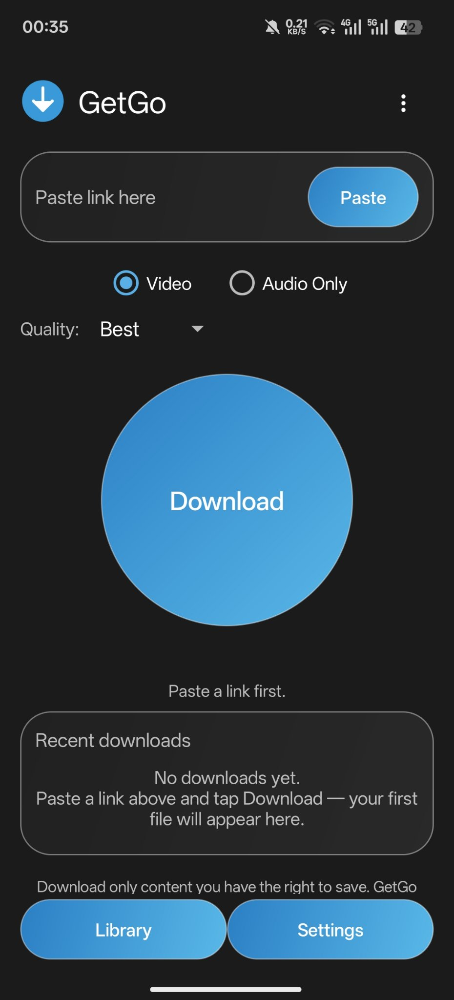

# GetGo

A simple, easy, fun, open-source Android downloader.
Paste a link, tap one big button, done. No account, no ads, no tracking.
By Taki — GitHub: takidz507 — https://github.com/takidz507/getgo

## Download (latest: v2.4.0)

Get the APK from [Releases](https://github.com/takidz507/getgo/releases/latest).
Five files, same version, same code — pick yours:
- **Universal** (194 MB) — if you don't know your phone's chip, take this one.
- **arm64-v8a** (55 MB) — modern phones, including OnePlus Ace 3.
- armeabi-v7a (48 MB), x86 (53 MB), x86_64 (58 MB) — older phones / emulators.

In the app, ⋮ → update check shows a dot when a new version is out.

## Proven on a real phone

Downloaded successfully on-device: TikTok, YouTube, Facebook,
public Instagram posts, and real Pinterest videos. Login-gated /
private Instagram content is expected to fail by design (see below).

## What GetGo does (v2.4.0)

- **Design 1 — One-Tap Hero, unchanged:** paste a link on top,
  one large central Download button, recent downloads as chips
  below, bottom navigation with Downloads and Settings only.
- **Download capability ONLY — not a full OmniGet clone.**
  No PDF/EPUB reader, no music player, no 158 tools, no
  flashcards, no MCP, no torrent, no course login. Those
  desktop-OmniGet features are deliberately out of scope.
- **Site downloads via yt-dlp:** paste ANY link yt-dlp
  supports — YouTube, TikTok, Instagram, X, Facebook, Vimeo,
  and the rest of yt-dlp's extractor list — and it goes through
  the same generic flow: title preview, real quality choice,
  Video or Audio Only, download, local library. There is no
  per-site allowlist in v2; if yt-dlp recognises the link it
  is attempted, and if it does not, the failure is shown
  honestly instead of saving an HTML page as a fake video.
- **Real quality, not a fake spinner:** Video quality maps to
  a real yt-dlp format selector (Best, or a height cap of
  1080p / 720p / 480p / 360p). A capped choice has NO final
  "/best" fallback, so a video with no stream at or below the
  cap fails clearly instead of silently downloading a higher
  quality than chosen. Audio Only uses bestaudio + FFmpeg
  extraction to MP3 (128K / 96K / best VBR).
- **Direct file links still work** (.mp4, .mp3, .pdf, .zip, …)
  on the fast v1 path, without touching the extractor.
  Playlists are NOT downloaded whole: `--no-playlist` is
  always passed, so a playlist link downloads only that video.
- **Local library** of files this app downloaded, saved to
  `Download/GetGo` on the device. Tap a file to try to open it
  with another app.
- **Settings (simple, unchanged):** Dark mode toggle, Liquid
  Glass toggle (default OFF), a small About card, a GitHub
  line, and a legal note.
- **No account, no ads, no telemetry, no server.** Your files
  stay on your device. Permissions are `INTERNET` and
  `ACCESS_NETWORK_STATE` only — the extractor needs no new
  permission, because it writes under the app's own external
  files dir first and the app then moves the finished file
  into Download/GetGo via MediaStore, exactly as v1 did.

## What GetGo v2 does NOT do — read this before judging it

- **No DRM breaking, no paywall bypass, no login for an
  account you do not own.** Sites that need those simply
  fail in the extractor, and that is by design, not a bug
  to be "fixed" by a bypass.
- **No torrent / magnet.** Deliberately out of scope.
- **No Udemy / Hotmart course downloader with login.**
  Out of scope.
- **No in-app player, no flashcards, no MCP, no 158 tools.**
  Those belong to desktop OmniGet, not to this simple app.
- **Pause / Resume (v2.4.0):** pause in the app or in the
  notification, resume later — even after leaving the app.
  Site downloads use yt-dlp `--continue`; direct files use
  HTTP Range. One paused download at a time.
- **Background downloads (v2.3.0):** downloads continue in a
  foreground service with a live % notification and Cancel;
  share a link to GetGo to start a download without opening
  the main screen.
- **yt-dlp nightly auto-update (v2.1.0):** once per app
  process, before the first site download, GetGo tries the
  latest nightly yt-dlp and falls back to the bundled one if
  the update fails.
- **Site extractors break when sites change.** yt-dlp's
  extractors are maintained upstream; a site that worked
  yesterday can fail tomorrow until yt-dlp is updated — which
  is why the nightly update above exists.

## Size — honestly

- v1 was 38,028 bytes because it had zero dependencies.
- v2.4.0 bundles a Python runtime + yt-dlp + FFmpeg. The
  arm64-v8a APK is 55 MB (universal: 194 MB) — most of it is
  FFmpeg (~35 MB) and Python (~14 MB), not the app's own code
  or design (under 1 MB). Per-ABI builds (v2.3.4) already
  shrank the download from 194 MB to 55 MB for modern phones.

## Licenses in v2 — all open source, no proprietary component

- **GetGo itself: GPL-3.0.** See `LICENSE`.
- **youtubedl-android 0.18.1** (`io.github.junkfood02.youtubedl-android:library`
  and `:ffmpeg`, by yausername): **GPL-3.0**, as listed on
  the upstream repository and on Maven Central. This is
  compatible with GetGo's GPL-3.0; no licence conflict was
  introduced by adding it.
- **yt-dlp** (bundled inside youtubedl-android, lazy
  extractors build): **Unlicense** (public-domain-like),
  permissive and compatible with GPL-3.0 distribution.
- **FFmpeg** (bundled via the `:ffmpeg` artifact, used for
  merging video+audio and for `--extract-audio`): free
  software under the LGPL/GPL family. GetGo adds no
  proprietary codec, extractor, or binary of its own.
- **Python 3.8 runtime** (bundled inside youtubedl-android):
  **Python Software Foundation licence**, permissive.
- **No component was added whose licence is unclear or
  proprietary.** If a future component's licence is unclear,
  it must be flagged and left out, not silently included.

## Polish in v2 (inside the locked scope)

Same as v1, unchanged: beautiful empty states for Recent
and Library, light press feedback, and the AnimHelper
animations (press shrink, download pulse, fades, completion
bounce), all respecting Android's animator-duration-scale = 0
(animations off = instant changes). See v1 README/BUILD for
the full animation list; nothing was added that loops,
blocks, or delays a tap or download.

## Liquid Glass — honest wording

The Liquid Glass toggle is an **Android frosted-glass lookalike**
(translucent cards with a soft stroke). Android has no native
Apple Liquid Glass, and GetGo does not claim to use it. It is
off by default so the app stays light and fast.

## Legal note

Download only content you have the right to save. GetGo does
not break DRM or paywalls, and does not download paid courses
you did not buy. The same note appears inside the app, in
Settings and under the home screen.

## Build

- Gradle project (see `app/build.gradle`, `settings.gradle`).
  A GitHub Actions workflow (`.github/workflows/build-apk.yml`)
  builds `assembleDebug` for all five variants (universal + 4
  per-ABI) and uploads them as artifact `GetGo-debug`.
- v2.4.0 is built, byte-verified (aapt + apksigner) and
  released: https://github.com/takidz507/getgo/releases/tag/v2.4.0
- **Still untested on-device:** pause/resume itself (v2.4.0),
  and long background downloads under battery optimisation.

## Ideas proposed but NOT implemented

These were left out on purpose and need Taqi's explicit
say-so before being added:

1. An in-app media player, and Arabic UI localisation.
2. Playlists / download queue — parked by Taqi as
   "ربما فيما بعد" (2026-11-04); see `NOTES.md`.
3. Instagram login / cookies — explicitly declined by Taqi
   ("لا تفعلها", 2026-11-03); do not build unless he asks again.
4. F-Droid submission — parked by Taqi ("خلي فيما بعد",
   2026-11-04).

## License

GPL-3.0. See `LICENSE`. Developer credit in the app: Taki
(small engraved-style text in Settings → About, not a banner).
